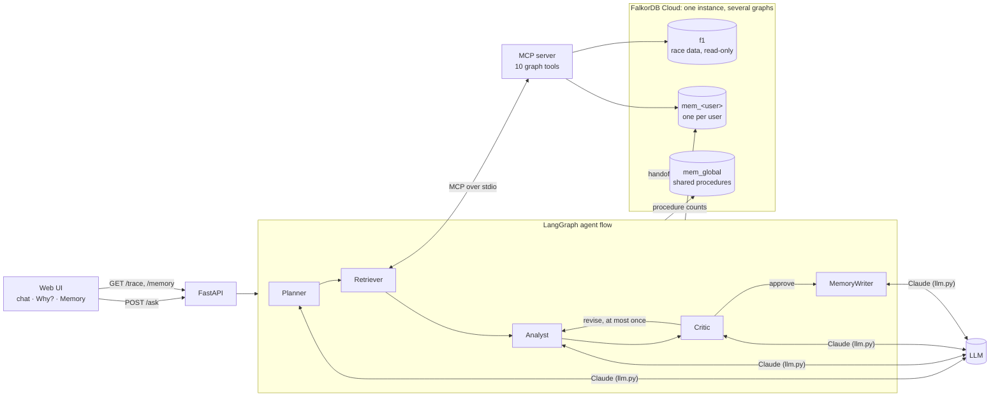
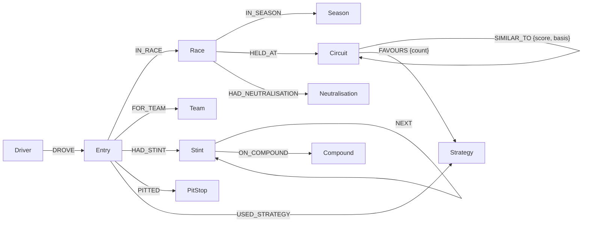
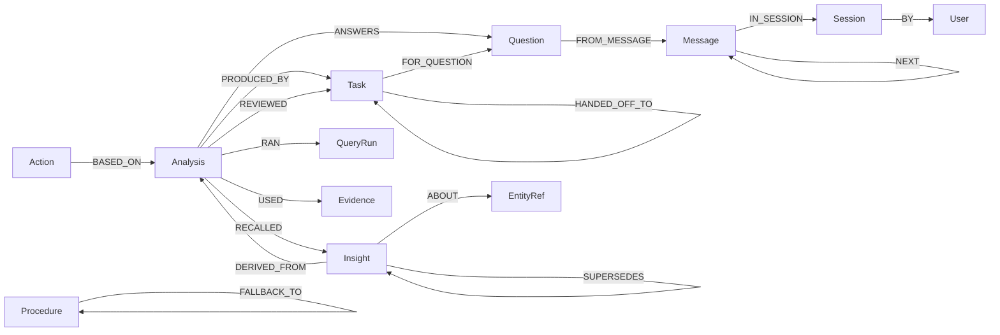

# PitGraph

**An F1 race-strategy assistant whose agents reason over a graph and remember what they learn.** You ask a strategy question, such as *"Is a one-stop viable at Monza in case of an early safety car?"*. A team of agents queries three seasons of race data (2023-2025) in FalkorDB, answers with a confidence score, and shows the evidence subgraph behind the answer. Each user has their own memory graph, which persists across sessions, so the agents build on what they learned before. They also learn which tool sequences work for each kind of question.

Built for **Graph Hacks** (FalkorDB), entered in tracks:
- **Track 1: Agents That Act on Connected Data**
- **Track 2: Agent Memory and Coordination**

**Live demo:** https://wmdfalkor-pitgraph.onrender.com/
(Render free tier: the agent is asleep when idle, so the first boot may take up to 1 minute.)

---

## What it does

| | |
|---|---|
| **Graph-grounded answers** | Agents call graph tools over **MCP** (Cypher queries plus PageRank, label propagation and shortest path). The LLM picks the tools and arguments it needs, but it does not write Cypher. |
| **Traceable** | Every answer stores the race nodes that it relied on. The **Why?** panel draws them all as a subgraph, along with the agent handoff chain, every tool call (including the failed ones) and the Critic's review. |
| **Recovers when data is thin** | If a circuit has too little or no data, the Retriever adds similar circuits (`SIMILAR_TO`) and strategy clusters (community detection). The answers mention this as well. |
| **Acts** | For a strategy question, it saves a strategy brief (primary plan, fallback, safety-car window) as an `Action` node. |
| **Remembers, per user** | Episodic memory (sessions, messages, past answers), semantic memory (insights that later answers **confirm**, **contradict** or **supersede**), and procedural memory (which tool plans work, shared across users). |
| **Coordinates** | Planner → Retriever → Analyst → Critic → MemoryWriter. Each handoff is written to the graph as a `Task` node, and the Critic can send an answer back once for revision. |

Data: public F1 data from [Jolpica-F1](https://github.com/jolpica/jolpica-f1) and [OpenF1](https://openf1.org), 2023–2025 seasons. All of this amounts to 70 races, ~1400 driver entries, ~4000 tyre stints, ~2400 pit stops and 90 stoppage periods (full safety car, virtual safety car, red flags).

---

## Architecture



**Request flow for one question**
1. **Planner:** loads the session's last 6 messages and the best known plan per intent from `mem_global`. It rewrites follow-ups into a standalone question, picks the circuits and an intent (`strategy_choice`, `sc_impact`, `circuit_comparison`, `memory_recall`, `general`), recalls the user's insights about those circuits, and chooses a tool sequence.
2. **Retriever:** calls the planned tools over MCP. If a circuit's own data comes back thin (fewer than 3 rows), it runs the recovery tools.
3. **Analyst:** writes a verdict, reasoning, confidence and the evidence it cited. Cited IDs that don't appear in the retrieved rows are dropped.
4. **Critic:** approves, or sends the answer back once with a note.
5. **MemoryWriter:** stores the answer, evidence, reviews and recalled-insight links. It updates the plan's success count and writes 0–2 insights after a real approval. For strategy questions it also saves a brief.

---

## Graph data model

One FalkorDB Cloud instance holds several graphs (multigraph):

| Graph | Holds | Written by |
|---|---|---|
| `f1` | Race layer: public F1 data. Shared, read-only at runtime | Ingestion |
| `mem_<user_id>` | One isolated memory graph per user | Agents |
| `mem_global` | Procedural memory shared by all users (tool names only, no user data) | Agents |

Separate graphs keep each user's memory isolated without any extra deployments, and keep the race data clean. Cypher can't traverse between graphs, so memory points into `f1` through `Evidence` / `EntityRef` stub nodes (`ref_label`, `ref_id`), which the trace resolves in a second query.

### Race layer (`f1`)



- **`Entry`** is one driver at one race (grid, finish, status, stops). Stints, pit stops and the team attach to it.
- **A strategy is a path:** `Entry -HAD_STINT-> Stint -NEXT-> Stint …`, each stint `ON_COMPOUND`. It's also stored as a `Strategy` node (`"M-H"`, `"S-M-H"`).
- **Derived edges** (computed after ingestion, see [QUERIES.md](QUERIES.md)):
  - `SIMILAR_TO`: each circuit's 3 closest circuits by type, lap length, pit loss, average stops and safety cars per race. `basis` holds the shared traits (e.g. `"street,low_sc,one_stop"`), so the agent can explain the match.
  - `FAVOURS`: each circuit's dominant dry-race strategy among top-10 finishers. It's stored as a real edge because FalkorDB algorithms run on stored edges.

### Memory layer (`mem_<user_id>`, `mem_global`)



| Memory type | Nodes | How it's used |
|---|---|---|
| **Episodic** | `Session`, `Message`, `Question`, `Analysis`, `QueryRun` | Follow-up questions use the session's `NEXT` chain. Every tool call is logged, failures included |
| **Semantic** | `Insight` → `ABOUT` → `EntityRef` (a circuit) | Recalled before planning. A new answer can confirm one (count + running-average confidence), contradict it (both kept, conflict shown) or supersede it (old one retired from recall, kept as history) |
| **Procedural** | `Procedure {intent, tool_sequence, success_count, fail_count}` in `mem_global` | The Planner reuses the best plan per intent, ranked by the smoothed success rate `(successes + 1) / (uses + 2)` |
| **Coordination** | `Task` chain via `HANDED_OFF_TO` | The trace walks it as a variable-length path, so a "revise" round needs no special case |

---

## Tools (MCP server)

`pitgraph/mcp_server/server.py` exposes these tools. Every query and algorithm call is listed with an explanation in **[QUERIES.md](QUERIES.md)**.

| Tool | What it answers | Graph feature |
|---|---|---|
| `list_circuits` | Maps "Singapore" to `marina_bay` | |
| T1 `winning_strategies` | Tyre sequences of the top-N finishers at a circuit | Stint path traversal |
| T1b `strategy_outcomes` | Every strategy ranked by positions gained (negative = avoid) | Aggregation |
| T2 `similar_circuits` | The 3 most similar circuits and why | `SIMILAR_TO` |
| T3 `neutralisation_impact` | Each SC / VSC / red flag and who pitted under it | `OPTIONAL MATCH` |
| T4 `recall_insights` | The user's current insights about circuits, with conflicts | Memory graph |
| T5 `trace` | The evidence subgraph and handoff chain behind an answer | Two-graph lookup, variable-length path |
| T6 `strategy_clusters` | Circuits that win with the same strategy | **Label propagation** (community detection) |
| T7 `key_races` | Which past races carry the most weight as evidence | **PageRank** |
| T8 `strategy_path` | How two circuits are connected | **Shortest path** (`algo.SPpaths`) |

`user_id` for T4/T5 is filled in by the agent runtime from the session, never by the model, so a prompt can't read another user's memory. Bad arguments return an error the model can fix (e.g. "Unknown circuit … Call list_circuits").

---

## Run it

### Requirements
- Python 3.11
- A FalkorDB Cloud instance (free tier is enough)
- An Anthropic API key (the agents use Claude, configured in `pitgraph/llm.py`)

### 1. Configure
```bash
cp .env.example .env    # fill in your env variables here
```

| Variable | Meaning |
|---|---|
| `FALKORDB_HOST`, `FALKORDB_PORT`, `FALKORDB_USERNAME`, `FALKORDB_PASSWORD` | FalkorDB Cloud connection |
| `LLM_API_KEY` | Anthropic API key |
| `LLM_MODEL` | Model ID (default `claude-sonnet-5-5`) |
| `LLM_WORKSPACE_ID` | Only if your key isn't scoped to a workspace |
| `MAX_CONCURRENT_ASKS` | Questions allowed at once (default 4; my deployment uses 2 since render only provides 512 MB on free tier) |

### 2. Install and load the race graph
```bash
python -m venv .venv
source .venv/bin/activate          # Windows: .venv\Scripts\activate
pip install -r requirements.txt

python -m pitgraph.graph.db        # connection smoke test
python -m pitgraph.rebuild         # build f1: indexes, ingestion, derived edges, verification
```
`rebuild` downloads the public APIs on the first run (about 12 minutes, rate-limited) and caches the responses in `data/raw/`, so later rebuilds take about 10 seconds. It checks the result against known-good counts and exits with an error if anything doesn't match. User memory graphs are never touched.

### 3. Ask
```bash
uvicorn pitgraph.api.main:app --port 8000      # web UI at http://127.0.0.1:8000
python -m pitgraph.ask --user demo "Best strategy at Monza for a top-5 finish?"   # or the CLI
```

### Docker
```bash
docker build -t pitgraph .
docker run -d --env-file .env -p 8000:8000 pitgraph
```
The container listens on `$PORT` if it's set (Render sets it) and on 8000 otherwise. The live demo runs this image on Render's free tier, with the same variables set in the Render dashboard.

### Tests
```bash
pytest          # 38 tests, run against the live FalkorDB instance
ruff check pitgraph
```

### API
| Endpoint | |
|---|---|
| `POST /ask` | `{"user_id", "question", "session_id"?}` → answer, confidence, evidence, tool calls, insights, `a_id` |
| `GET /trace/{a_id}?user=` | The evidence subgraph, handoffs, reviews and insights for one answer (404 for another user's answer) |
| `GET /memory?user=` | The user's insights, past answers, briefs and node counts, plus shared procedures |

---

## Example questions
- *Best strategy at Monza for a top-5 finish?*
- *Is a one-stop viable at Monza if there's an early safety car?* (Monza has no safety cars in the data, so the recovery path runs)
- *How does Singapore compare to Monza strategically?*
- *What do you know about Monza?* (in a new session, this answers from memory)

## Limitations
- **No login.** The client chooses `user_id`, which is fine for a demo but means anyone who knows a user ID can read that user's memory.
- **Free tiers.** Render sleeps when idle (about 1 minute to wake). FalkorDB's free instance stops after a day unused. If `f1` is lost, `python -m pitgraph.rebuild` restores it, but user memories can't be restored.
- **Scope.** Race sessions from seasons 2023–2025 only, with no lap telemetry.

## Project layout
```
pitgraph/
  ingest/       Jolpica + OpenF1 download (cached), graph load, derived data
  graph/        FalkorDB connection, indexes, the T1–T8 queries
  mcp_server/   the MCP server exposing the tools
  agents/       planner, retriever, analyst, critic, memory, insights, flow (LangGraph), MCP client
  api/          FastAPI app and Memory-panel reads
  web/          single-page UI (vis-network for the evidence graph)
  llm.py        the one LLM interface
  ask.py        CLI
  rebuild.py    one-command rebuild of the race graph
tests/          integration tests against FalkorDB
```

## AI usage
All AI assistance during the build is disclosed in [AI_USAGE.md](AI_USAGE.md).
